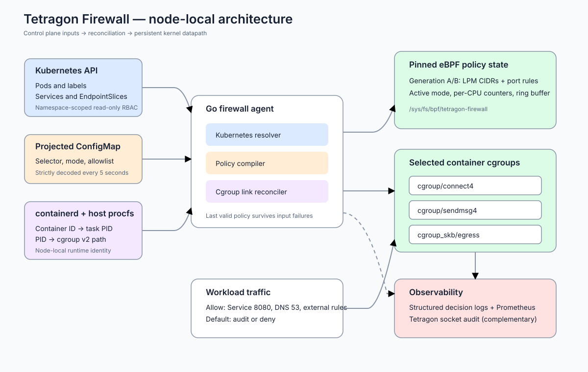
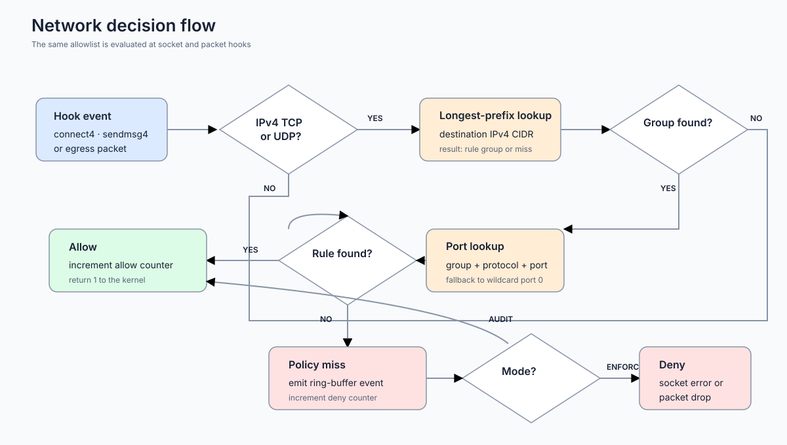
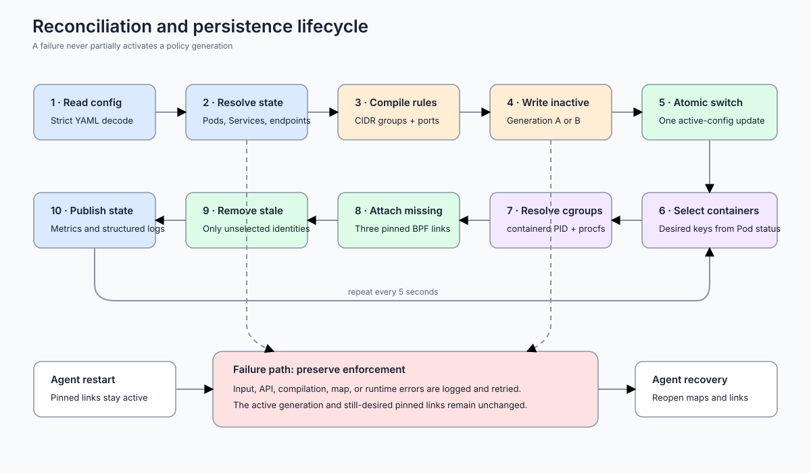

# Architecture

## Purpose

Tetragon Firewall is a node-local IPv4 egress firewall for selected Kubernetes Pods. A Go controller translates Kubernetes identity and a declarative allowlist into eBPF maps, then attaches three programs to every selected container cgroup.

## Components

### Firewall agent

The agent runs once per node as a DaemonSet. It performs four independent jobs:

1. Read and strictly validate the projected ConfigMap every five seconds.
2. Query Pods, Services, and EndpointSlices through namespace-scoped Kubernetes RBAC.
3. Resolve container IDs to host PIDs through containerd and derive their cgroup v2 paths from host procfs.
4. Compile rules, update eBPF maps atomically, and reconcile persistent cgroup links.

### eBPF datapath

The datapath contains these hooks:

- `cgroup/connect4`: rejects disallowed TCP connects and connected UDP sockets before traffic is sent.
- `cgroup/sendmsg4`: rejects UDP datagrams that specify a destination without first calling `connect()`.
- `cgroup_skb/egress`: validates outbound packets, including packets belonging to connections established before a policy update.

The socket hooks return an error to userspace. The packet hook returns zero to drop a packet. In audit mode, the same lookup is performed but traffic remains allowed.

### Policy maps

Two complete generations of maps exist:

- an IPv4 LPM trie maps the longest matching CIDR to a rule-group identifier;
- a hash map keyed by `{group, protocol, destination port}` stores allow decisions;
- a one-element array selects the active generation and audit/enforce mode;
- a per-CPU array stores low-cardinality decision counters;
- a ring buffer transports denied or would-be-denied events to userspace.

The controller clears and populates only the inactive generation. It switches the active generation with one map update after every write succeeds. A failed compilation or map update therefore leaves the previous policy active.

### Persistent state

Maps, programs, and cgroup links are pinned below `/sys/fs/bpf/tetragon-firewall`. Closing the userspace agent does not detach pinned links. After restart, the agent reopens compatible maps and links, loads the current program version, and resumes reconciliation.

## Address resolution

The controller adds both a Service ClusterIP and its ready EndpointSlice addresses. This supports datapaths that expose either the pre-DNAT or post-DNAT destination to `cgroup_skb`. The same rule applies to the configured DNS Service, restricted to TCP and UDP port 53.

External entries remain explicit IPv4 CIDR, protocol, and port combinations. Nested external CIDRs are rejected because a single longest-prefix result cannot safely express the union of two independent port sets.

## Reconciliation

The desired-link set is based on container identity before runtime lookup. If a containerd task is temporarily unavailable during a restart, its existing pinned link remains desired and is not removed. Links are removed only after the container no longer appears in the selected Pod set.

## Tetragon integration

Tetragon is observation-only in this project. Its namespaced tracing policy records socket connection attempts for the same Pod label selector. The custom ring buffer remains authoritative for firewall decisions, particularly for UDP `sendmsg()` traffic.
